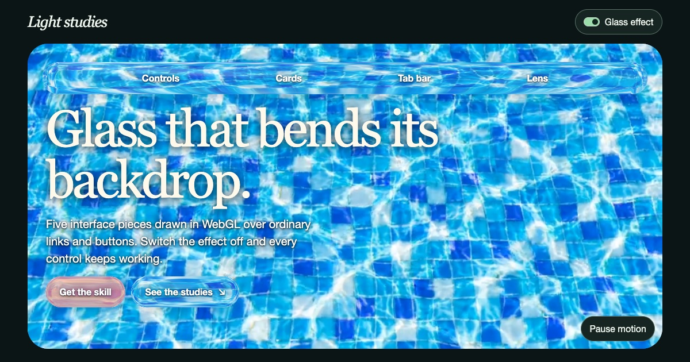

# Liquid Glass Skill for Codex and Claude Code

Build refractive navigation, buttons, cards, tab bars and lenses for the web. This agent skill integrates Zerowing’s WebGL renderer with ordinary HTML controls. It includes iPhone Safari guidance, a self-hosted browser module and a five-scene gallery that stays usable with JavaScript or WebGL disabled.

**[Open the live gallery](https://owgit.github.io/liquid-glass-skill/examples/iphone/)** · [Read the skill](skills/liquid-glass-web/SKILL.md) · [Component recipes](skills/liquid-glass-web/references/recipes.md) · [Review the bundled engine](docs/upstream-review.md)

[](https://owgit.github.io/liquid-glass-skill/examples/iphone/)

## Install for Codex and Claude Code

On macOS or Linux, clone the project and run the local installer.

```sh
git clone https://github.com/owgit/liquid-glass-skill.git
cd liquid-glass-skill
sh scripts/install.sh
```

The installer copies the complete skill into both clients’ personal skill folders. It requires no package manager, network access or administrator privileges after cloning. A repeat install recognizes identical files. If you have edited an installation, the installer identifies the path and preserves your copy. Move the old version aside to install a changed release.

| Scope | Command from the checkout |
| --- | --- |
| Codex only | `sh scripts/install.sh --codex` |
| Claude Code only | `sh scripts/install.sh --claude` |
| Both clients in an existing project | `sh scripts/install.sh --project /path/to/project` |

To install manually, copy the entire `skills/liquid-glass-web` directory into `~/.agents/skills/` for Codex or `~/.claude/skills/` for Claude Code. Keep the folder name `liquid-glass-web`. [Codex skill locations](https://developers.openai.com/codex/skills) · [Claude Code skill locations](https://code.claude.com/docs/en/skills)

## Use the skill

**Codex**

```text
Use $liquid-glass-web to add a refractive toolbar to my Next.js product page.
Keep its links in the server-rendered HTML and keep the controls readable on iPhone.
```

**Claude Code**

```text
/liquid-glass-web Review my mobile navigation. Add an optional glass mode
and keep keyboard focus, link destinations and the solid appearance working.
```

## What the gallery shows

| Scene | Glass pieces | Backdrop |
| --- | --- | --- |
| Hero | Navigation bar, tinted primary button, secondary button | Pool video |
| Buttons and controls | Buttons, a switch and a segmented control that change the scene’s `dim` and `colors` | Generated aurora |
| Cards and players | A notice and a player whose button pauses the backdrop | Pool video |
| Tab bar | Four tabs that switch a view in place, a lens that glides to the selected tab and follows a drag, and a round action | Generated aurora, one palette per view |
| Lens | A magnifier you drag or move with the arrow keys | Pool still |

Every scene starts as a still image with solid HTML links and buttons. On supported browsers WebGL then refracts the backdrop through the same controls. Toggle **Glass effect** to compare transparent and solid controls across the whole page. Video playback pauses when its scene leaves the viewport or the tab is hidden. Reduced-effects preferences keep the still images and solid controls. If autoplay is blocked, **Play motion** starts playback on request. The variables behind each piece are listed in the [component recipes](skills/liquid-glass-web/references/recipes.md).

The seven-second pool loop animates the light in Zerowing’s original pool backdrop. This demo serves the video and its matching still image locally. [Original pool image](https://github.com/MuhammadaliMS/liquid-glass/blob/32cd7f8f45a782ba1f209295d8358d3c855c4aa5/site/backdrops/pool.webp) · [Upstream license](skills/liquid-glass-web/assets/LICENSE.zerowing)

To run the example locally from the repository root:

```sh
python3 -m http.server 8000 --bind 127.0.0.1
```

Open `http://127.0.0.1:8000/examples/iphone/`. [Example source](examples/iphone/) · [iPhone accessibility and performance checks](skills/liquid-glass-web/references/mobile-web.md)

## Where the glass works

| Use case | Implementation |
| --- | --- |
| HTML or a client-rendered app | Self-host the bundled module and mark the controls inside a scene with the `glass` attribute. |
| React or Next.js with server rendering | Render the links and labels on the server. Load the WebGL module on the client after mount or interaction. |
| A toolbar over a photo or a video | Use that backdrop in the scene. The renderer samples the scene’s backdrop texture. |
| A fixed bar over arbitrary scrolling page content | Use a solid surface or CSS backdrop filtering. The WebGL scene cannot sample unrelated DOM behind it. |
| Native iOS app | Use SwiftUI or UIKit and the platform’s Liquid Glass APIs. This skill is designed for browser interfaces. |

## Source and license

Uygar Duzgun maintains the agent instructions, installer and demo under the [MIT License](LICENSE). The bundled WebGL renderer is Zerowing’s Liquid Glass 1.1.1, distributed with its [original MIT notice](skills/liquid-glass-web/assets/LICENSE.zerowing). The review records the exact source revision, file digest and integration limits. [Upstream project](https://github.com/MuhammadaliMS/liquid-glass) · [Release review](docs/upstream-review.md)
